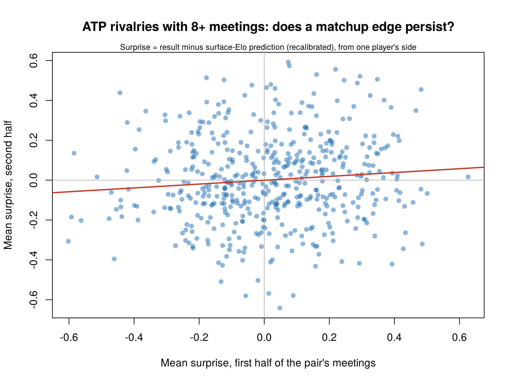

# Tennis matchup effects and PELO

Do ATP players have matchup effects (pair-specific edges, the raw material of intransitivity), and does
**PELO** ([kh-w/PELO](https://github.com/kh-w/PELO)), an Elo rating system with a pairwise advantage term,
capture them?

**Question.** Tennis is full of "bad matchups": a player who beats almost everyone but keeps losing to one particular
opponent. If such pair-specific effects exist, win probabilities can't come from one strength number per player, and
PELO's pairwise term should help. This analysis tests that in three ways:

1. Does PELO beat Elo, with and without surface ratings?
2. A model-free test: does a pair's early surprise carry over to their later meetings?
3. Does PELO find rock-paper-scissors cycles?

## Data
- All ATP tour-level main-draw singles matches, January 1991 to December 2024: Grand Slams, Masters, ATP 250/500 and
  the Tour Finals. 86,315 completed matches, 2,246 players. Qualifying, Davis Cup, Challengers, retirements and
  walkovers are excluded.
- Source: the deuce package's copy of Jeff Sackmann's `tennis_atp` data, in
  [skoval/deuce](https://github.com/skoval/deuce). Players are identified by Sackmann's player id. Matches are ordered by
  tournament start date, then round.
- Pinnacle closing odds (from tennis-data.co.uk, in the same package) are matched to Grand Slam matches by year, Slam
  and both surnames. 7,854 matches have odds.

## Setup
- Sequential updates. Four models, each fitted by maximum likelihood on the first 69,052 matches (to February 2017):
  - **Elo:** one rating per player (K).
  - **PELO:** Elo plus the pairwise advantage (K, K2).
  - **sElo:** Elo plus one extra rating per player per surface: hard, clay, grass and carpet (K, Ks).
  - **sPELO:** sElo plus the pairwise advantage (K, Ks, K2).
- The surface models matter because an apparent "matchup" (a clay specialist against a grass-court player) could just
  be surface.
- Test: the last 17,263 matches (February 2017 to December 2024), predicted walk-forward. 43% of test matches were
  between players who had met before at tour level, 13% between players who had met at least 3 times.

## Results

### 1. The likelihood wants a pairwise term

| Model | K | Ks | K2 | Training NLL |
|---|---|---|---|---|
| Elo | 25.3 | – | – | 42,219.2 |
| PELO | 25.2 | – | **11.8** | 42,211.7 |
| sElo | 20.7 | 12.9 | – | 41,781.0 |
| sPELO | 20.5 | 12.9 | **12.2** | 41,773.1 |

Tour-level data give a clearly positive K2. (A Grand Slam-only version, where only 18% of test matches were rematches,
gave K2 = 0: Slam pairs meet again too rarely.) Adding the pairwise term improves the training likelihood by 7.5 (PELO vs Elo) and 7.9 (sPELO vs sElo), a
likelihood-ratio statistic of about 15–16 for one extra parameter. The improvement holds with surface ratings in the
model, so it isn't a surface effect. K2 profile (training NLL relative to K2 = 0):

| K2 | 0 | 1 | 2 | 5 | 10 | 20 | 40 |
|---|---|---|---|---|---|---|---|
| PELO | 0 | −1.26 | −2.39 | −5.10 | −7.37 | −4.14 | +29.68 |
| sPELO | 0 | −1.26 | −2.41 | −5.17 | −7.62 | −4.95 | +27.38 |

### 2. Model-free test: matchup edges persist

Using all matches from 1991 to 2024, for every pair that met at least 4 times compare their mean "surprise" in the first half of their meetings with the
second half. Surprise is the result minus the surface-Elo prediction, recalibrated, taken from one player's side. If
there is no pair-specific effect, the two halves are unrelated. Significance comes from re-pairing first and second
halves at random (5,000 permutations).

| Version | Pairs | Permutation p | Implied spread of true matchup effects (SD of win probability) |
|---|---|---|---|
| Surface-Elo surprise, pairs with 4+ meetings | 4,424 | 0.039 | 4.8 points |
| same, pairs with 8+ meetings | 487 | 0.023 | 6.3 points |
| **Adjusted for player form**, 4+ meetings | 4,424 | **0.014** | 5.8 points |
| **Adjusted for player form**, 8+ meetings | 487 | **0.010** | 7.3 points |

"Adjusted for player form" subtracts each player's average surprise that year against all *other* opponents. That
removes the chance that a player was simply under- or over-rated in a given year, and it makes the effect stronger.
So tennis does have pair-specific effects: a typical rivalry departs from what the two players' ratings imply by about
±6 percentage points of win probability.



(The red line is an unweighted fit, shown for illustration. The test itself weights pairs by number of meetings.)

### 3. The pairwise terms PELO learns are the famous rivalries

The largest pairwise advantages in the surface-PELO at the end of 2024, among pairs with at least 15 meetings:

| Favoured | Over | Meetings | Pairwise advantage (rating points) |
|---|---|---|---|
| David Nalbandian | Roger Federer | 15 | 57 |
| Novak Djokovic | Rafael Nadal | 51 | 41 |
| Rafael Nadal | Roger Federer | 38 | 35 |
| Roger Federer | Andy Roddick | 17 | 33 |
| Novak Djokovic | Roger Federer | 47 | 33 |
| Rafael Nadal | Richard Gasquet | 15 | 28 |
| Daniil Medvedev | Alexander Zverev | 18 | 25 |
| Pete Sampras | Andre Agassi | 24 | 24 |

Nadal over Federer survives even with surface ratings in the model. It is not just "Nadal on clay".

### 4. But the effect is small next to the noise, out of sample

Test-set log loss (17,263 matches):

| | Log loss | Brier | Accuracy | AUC |
|---|---|---|---|---|
| Elo | 0.62578 | 0.21826 | 64.2% | 0.709 |
| PELO | 0.62566 | 0.21821 | 64.2% | 0.709 |
| sElo | 0.62200 | 0.21651 | 65.2% | 0.716 |
| sPELO | **0.62185** | **0.21646** | **65.2%** | **0.716** |

- **Surface ratings help clearly:** sElo is better than Elo by 0.0038 per match (95% CI 0.0018 to 0.0057).
- **PELO's pairwise term points the right way but isn't significant:** PELO vs Elo −0.00012 (CI −0.00033 to +0.00010);
  sPELO vs sElo −0.00015 (CI −0.00036 to +0.00008).
- **Among repeat matchups (pairs with 3+ prior meetings, 2,237 matches)** the pairwise term doesn't help either:
  +0.0002 to +0.0003, with CIs around ±0.0013.

The persistence test explains why. True matchup effects of about ±6 points are real, but a pair only meets a few
times, and each result is a coin flip weighted by about 6 points. PELO's online β, learned from a handful of
meetings, is mostly noise until a rivalry has run for many years. That is why the clearest β values belong to the
longest rivalries above.

### 5. Strict rock-paper-scissors cycles are rare and weak

Among the 44,585 triads in which all three pairs had met at least 3 times by 2017, the surface-PELO implies a cycle in
96 (0.2%). The strongest is Ivanisevic > Rusedski > Kucera > Ivanisevic, with legs of 52.4%, 53.5% and 53.0%.
Matchup effects in tennis shift probabilities by a few points, so they rarely overturn the rating order three times in
a row.

### 6. Betting: still no edge at Grand Slams

On the 2,319 Grand Slam test matches with Pinnacle closing odds (2017–2023), the market's log loss is 0.4925, against
0.5324 for sElo and 0.5325 for sPELO. Value betting at Pinnacle's prices (average margin 2.4%) loses heavily for every
model: ROI from −12.4% (sElo, 95% CI −19.6% to −5.6%) to −14.9% (Elo, −21.7% to −7.5%), over 2,080–2,099 bets. When a
rating model disagrees with Pinnacle at a Slam, Pinnacle is usually right.

## Takeaways
- **Tennis matchup effects exist**, as tested here without relying on PELO. Pairs have persistent edges of about
  ±6 percentage points beyond player and surface strength (p ≈ 0.01 after adjusting for player form). PELO's fitted K2
  is clearly positive, and its biggest pairwise terms are well-known rivalries.
- **Most of this is pair-specific bias, not intransitivity in the strict sense.** Fully cyclic triads are rare (0.2%)
  and weak.
- **For prediction, the pairwise term is a small, non-significant gain.** Surface ratings are worth far more. A
  pairwise term would need shrinkage, or to share information across similar matchups (e.g. playing style or
  handedness), to turn real matchup effects into better forecasts.

## Model

P(A beats B) = 1 / (1 + 10^(−(r_A + s_A,surface + β_AB − r_B − s_B,surface)/400)).

After each match with result y (1 if A won):
- r moves by K·(y − p);
- the surface ratings s move by Ks·(y − p) (surface models only);
- β_AB moves by K2·(y − p), with β_BA = −β_AB.

Elo is K2 = 0 without surface ratings. With surface ratings off, the engine reproduces `PELO::run_pelo` and
`PELO::get_negloglike_pelo` exactly (`tests/test_engine.R`). Parameters are fitted by maximum likelihood on the
training matches, starting from several points. Test matches are predicted walk-forward, and confidence intervals
come from bootstrapping matches.

## Reproducing

Requires R with `PELO` (`remotes::install_github("kh-w/PELO")`), `pROC` and `jsonlite`. Run from the repository root:

```bash
bash data-raw/fetch_sources.sh      # download the data at a pinned commit
Rscript data-raw/build_games.R      # build data/tennis_atp_tour_games.csv
Rscript tests/test_engine.R         # engine == PELO package
Rscript run.R                       # about 10 minutes; writes results/
```

`results/summary.json` holds every number quoted above. `results/predictions.csv` has the four models' walk-forward
probabilities for every match.

## Data and licences

- Match results: Jeff Sackmann's [tennis_atp](https://github.com/JeffSackmann/tennis_atp), via the copy in
  [skoval/deuce](https://github.com/skoval/deuce) (commit `6f2be7a`), licensed
  [CC BY-NC-SA 4.0](https://creativecommons.org/licenses/by-nc-sa/4.0/). `results/predictions.csv` is derived from it
  and carries the same licence.
- Odds: Pinnacle closing prices compiled by [tennis-data.co.uk](http://www.tennis-data.co.uk), from the same package.
- The raw data are not included; `data-raw/fetch_sources.sh` downloads them.

## Layout

```
run.R                     the analysis (fits, tests, figures)
R/pelo_engine.R           PELO / Elo engine with optional surface ratings
R/evaluate.R              metrics, bootstrap, betting backtest, cycle count
data-raw/                 fetch_sources.sh (pinned download), build_games.R (match table)
tests/test_engine.R       engine vs the PELO package
results/                  summary.json, predictions.csv, matchup_persistence.png
```
